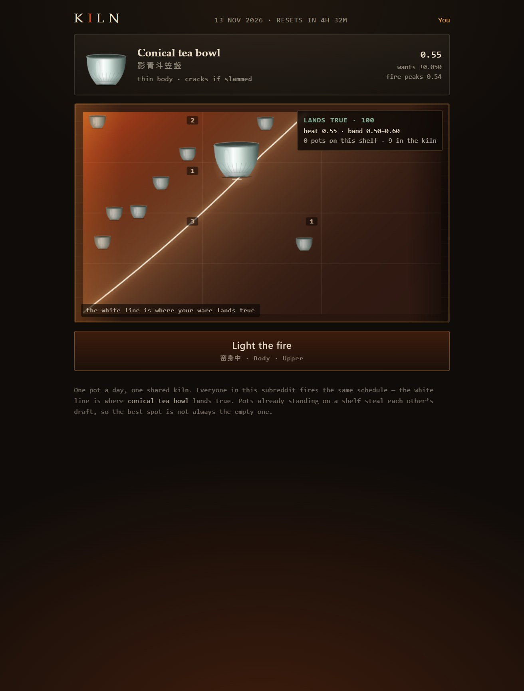
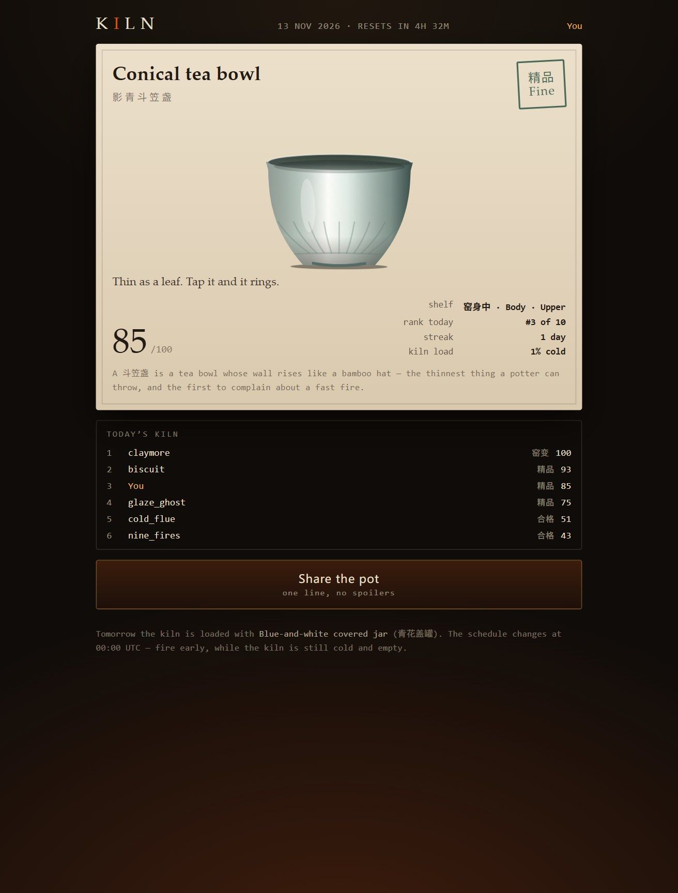

# KILN · 今日窑

**One pot. One firing. One shared kiln, every day.**

A daily game for Reddit, built on Devvit Web for
[Reddit's Game of the Day Hackathon](https://redditgameofday2026.devpost.com/).

You get one pot a day. Today's kiln burns one schedule, and everybody in the
subreddit fires into it. Where you stand decides what the fire does to your
clay — the fire mouth runs hot, the flue runs cold — and so does who is already
standing there, because pots packed into the same shelf steal each other's
draft. Then you have twenty-four seconds to hold the fire on the day's curve.

What comes out is one of six pieces of porcelain. The glaze is the result: read
the colour before you read the number.

<p align="center">
  
  
</p>

## Play

1. **Load.** Drag your pot anywhere inside the kiln. The pale line across the
   chamber is where today's fire lands *this ware* true; your readout says what
   the spot under your finger would do. Numbers in the corners are how many
   pots are already on that shelf.
2. **Fire.** Hold to feed, let go to let it breathe. The pot lags the flame by a
   couple of seconds, so stoke ahead of the dashed line, not at it. Thin bodies
   crack if you slam heat into them.
3. **Open.** The door comes up and the pot is whatever the fire made: sound,
   fine, overfired, underfired, crazed — or, once in a long while, a flambé.
4. Come back tomorrow. The kiln is reloaded with a different ware and a
   different schedule at 00:00 UTC, and your streak is waiting.

One pot per player per day. The board is the day's kiln, not a lifetime one.

## Why it is a Reddit game and not a game with Reddit paint

- **The kiln is shared and finite.** Crowding is real: every pot already on a
  shelf costs the next one heat, and a packed kiln runs cold for everyone. The
  best spot changes hour by hour as the subreddit piles in, so the comments fill
  with "the fire mouth is full, go up" — a coordination problem, not a score
  attack.
- **It is one object, one decision, one day.** No account, no grind, no meta.
  Everybody gets the same ware and the same schedule, so results are comparable
  and worth posting.
- **It ends.** A firing is 24 seconds. The day ends at 00:00 UTC. There is
  nothing to catch up on, which is what makes coming back cheap.

## Run it

Requires **Node 24** (the Devvit Web floor).

```bash
npm ci
npm run preview        # http://localhost:5173 — the whole game, no Reddit account
```

`npm run preview` serves the real built client against the real Hono routes,
with Redis swapped for a JSON file and a handful of rival pots seeded so the
crowd is visible. It is the same code path a subreddit runs.

```bash
npm run build          # client + server bundles into dist/
npm test               # 24 unit + integration tests
npm run verify         # everything: types, lint, tests, build, preflight, sweep, HTTP
bash scripts/verify.sh # the same thing, if you prefer the script
npm run shots          # re-capture proof/shots (needs Chrome + playwright-core)
npm run sweep          # 365-day balance report → proof/balance.md
```

### On Reddit

```bash
npx devvit login                          # needs a Reddit account
npm run dev                               # devvit playtest against a test subreddit
npx devvit upload                         # private upload is enough for judging
```

`devvit.json` ships with a moderator menu item ("Post today's kiln"), an
`onAppInstall` trigger that posts the first kiln, and a 00:05 UTC scheduler task
that posts a fresh thread each day (disable it in the app's subreddit settings
with `dailyPost`).

## What is real in here

| In the game | In Jingdezhen |
| --- | --- |
| Fire mouth / body / flue gradient, hotter up high | A wood kiln is a tunnel: temperature falls from the firebox to the chimney, and the same firing lands differently on every shelf. |
| Where you place the pot | 把桩 — the kiln master's core skill is *setting the stacks*, matching each ware to a position in the fire. |
| Pot crowding | Packed ware blocks the draft; a full kiln is a cold kiln. |
| The 24-second schedule | 升温曲线 — porcelain wants a controlled climb and a long soak, not a fast fire. |
| Thin bodies cracking | 惊釉 / 炸器: thermal shock. |
| 窑变 (flambé) | Copper-red under a reduction atmosphere: ten kilns, nine failures, and no two alike. |

## A port, honestly labelled

KILN is a port of **[把桩 / Ba Zhuang](https://github.com/hkmpn9s6dh-commits/hackathon-2026-ba-zhuang)**
(BOKE NEW WAVE 2026 entry, MIT, written by the same author). The lineage is
real, not a reskin:

- `src/shared/sim/kiln.ts` is 把桩's twelve-chamber heat model, re-read as a
  continuous field so a one-round game can have one continuous decision.
- `src/shared/sim/fire.ts` is 把桩's first-order fire, re-tuned from a
  twelve-时辰 night to a 24-second firing; the state variables (fuel, temp,
  stress, shock) are the same ones.
- `src/shared/sim/evaluate.ts` keeps 把桩's band-and-verdict model, with the
  firing quality folded in because a daily round has no second kiln.
- `src/client/render/pot.ts` is 把桩's procedural porcelain painter, plus a
  glaze mood derived from the heat the pot actually reached.

把桩 is a 15–20 minute single-player night. KILN is a 60-second daily round with
a shared kiln. Same craft, different shape — which is exactly what the
*Best Ported Daily Game* category is for.

## What is proved, and what is not

Proved, on every run of `npm run verify`:

- types, lint, 24 tests, a production build, and a static audit of `devvit.json`
  against the artifact (every declared endpoint is served, every entrypoint
  exists, no credentials, no off-domain loads);
- a year of daily content: 365/365 days reach **Fine** with careful play
  (`proof/balance.md`), and a careless player cannot;
- the score is a recount of the firing trace on the server, not a number the
  client sends.

Not proved here, because it needs a Reddit account: `devvit playtest`,
`devvit upload`, and the demo post. Those are in
[`docs/05-SUBMISSION.md`](docs/05-SUBMISSION.md).

## Layout

```
src/shared/      types + the simulation (pure functions, no DOM, no platform)
src/server/      Hono routes, a store interface with Redis and file backends
src/client/      React shell + canvas art (kiln map, fire, porcelain)
scripts/         preview, preflight, sweep, shots, verify.sh
docs/            the spec, the UI decision record, the proof, the submission pack
proof/           captured evidence: screenshots, balance table, clone check
```

## Licence

MIT. Art is drawn in code; there are no image or audio assets to license.
